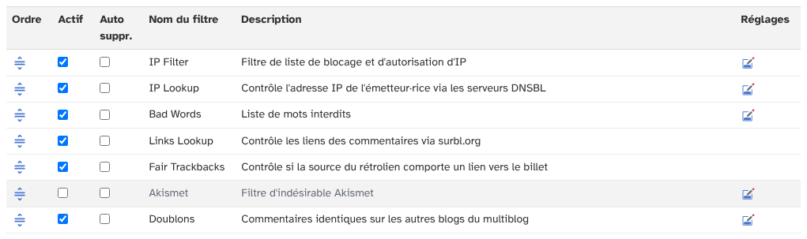
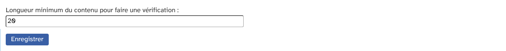
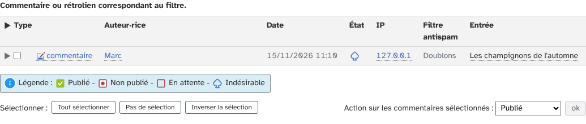

# Duplicate filter : guide d'utilisation

Ce guide explique comment le filtre antispam _Duplicate filter_ (« Doublons ») repère les commentaires copiés sur plusieurs blogs.

Ce plugin n'a pas de page d'administration propre. Il ajoute un filtre à la page _Antispam_ de Dotclear.

## Sommaire

* [À quoi sert le plugin](#à-quoi-sert-le-plugin)
* [Activer le filtre](#activer-le-filtre)
* [Régler la longueur minimum](#régler-la-longueur-minimum)
* [Comment le filtre décide](#comment-le-filtre-décide)
* [Retrouver les commentaires filtrés](#retrouver-les-commentaires-filtrés)
* [Bon à savoir](#bon-à-savoir)

## À quoi sert le plugin

Les robots postent souvent le même message sur tous les blogs d'une installation Dotclear.

Le filtre cherche si le même commentaire, envoyé depuis la même adresse IP, existe déjà sur un **autre blog** de l'installation. Si oui, il le classe comme indésirable.

Il n'a donc d'intérêt que si votre installation contient plusieurs blogs (multiblog).

## Activer le filtre

1. Allez dans _Plugins_ puis _Antispam_.
2. Dans la liste _Filtres d'indésirable disponibles_, repérez la ligne _Doublons_.
3. Cochez _Actif_ (c'est le cas par défaut) et enregistrez.

La colonne _Ordre_ fixe le moment où le filtre est appliqué par rapport aux autres. La case _Auto suppr._ supprime automatiquement les commentaires repérés par ce filtre.

## Régler la longueur minimum

Les commentaires très courts (« Merci ! ») sont souvent identiques sans être des spams. Le filtre les ignore.

1. Dans la ligne _Doublons_, cliquez sur l'icône de la colonne _Réglages_.
2. Saisissez _Longueur minimum du contenu pour faire une vérification_ (30 caractères par défaut).
3. Cliquez sur _Enregistrer_.

Ce réglage est commun à tous les blogs. Seul un super administrateur peut le modifier. Les autres personnes voient la valeur choisie, sans pouvoir la changer.

## Comment le filtre décide

Un nouveau commentaire est classé comme indésirable quand toutes ces conditions sont réunies :

* il fait au moins la longueur minimum ;
* un commentaire de **même contenu** et de **même adresse IP** existe sur un autre blog.

Dans ce cas, le filtre classe aussi comme indésirable le commentaire déjà présent sur l'autre blog.

Un commentaire en double sur le même blog n'est pas repéré à lui seul.

## Retrouver les commentaires filtrés

Allez dans _Blog_ puis _Commentaires_ et ouvrez la liste des commentaires indésirables.

La colonne _Filtre antispam_ indique ce qui a classé chaque commentaire : ici _Doublons_. Dans la fiche du commentaire, le message est « Filtré par Doublons (Doublon sur un autre blog) ».

Pour récupérer un commentaire à tort, cochez-le et choisissez l'action _Publié_.

## Bon à savoir

* Le contenu est comparé tel quel, caractère pour caractère. Une virgule en plus suffit pour qu'il ne soit plus reconnu.
* Quand un doublon est trouvé, seuls les commentaires des **autres blogs** sont aussi classés indésirables. Ceux du blog courant restent traités par les autres filtres antispam.
* Le commentaire de l'autre blog est classé indésirable sans qu'aucun message ne vous soit montré. Pensez à regarder les indésirables de vos autres blogs.
